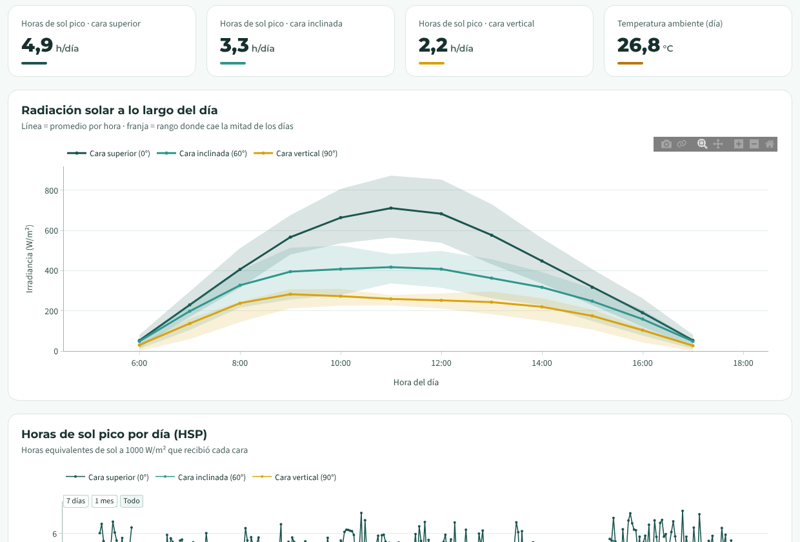
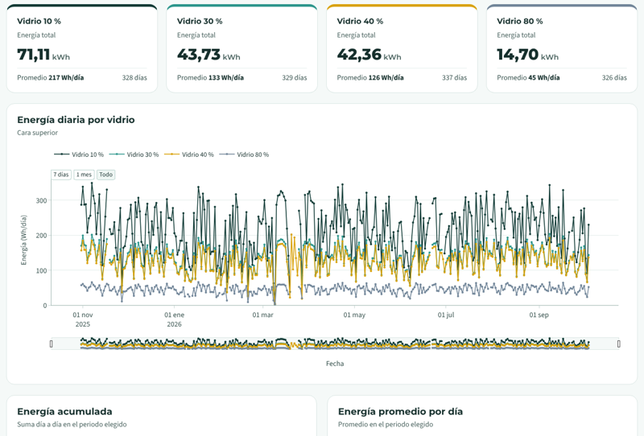
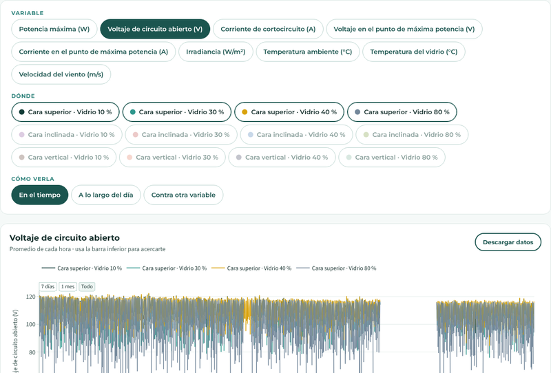

# VISOR-BIPV · Plataforma de monitoreo fotovoltaico

Plataforma web para visualizar los datos históricos de instalaciones fotovoltaicas: el recurso
solar y las condiciones del sitio, la energía generada por cada módulo y su desempeño (potencia y
eficiencia). Está construida con [Dash](https://dash.plotly.com/) y [Plotly](https://plotly.com/python/)
sobre bases de datos SQLite.

El primer caso es el **prototipo BIPV de Sumicol** (Medellín), desarrollado en el marco del Proyecto
Integra: doce módulos de vidrio fotovoltaico semitransparente con cuatro niveles de transmitancia
(10, 30, 40 y 80 %), montados en tres caras con inclinaciones de 0°, 60° y 90°. La plataforma no
está limitada a ese prototipo: cualquier instalación que prepare sus datos con el formato de carga
puede visualizarse con las mismas pestañas y gráficas.

| Clima | Energía | Explorar |
|---|---|---|
|  |  |  |

## Contenido

- [Funcionalidades](#funcionalidades)
- [Documentación](#documentación)
- [Cómo funciona](#cómo-funciona)
- [Instalación y uso local](#instalación-y-uso-local)
- [Formato de carga](#formato-de-carga)
- [Procesamiento de los datos](#procesamiento-de-los-datos)
- [Tus datos: bases propias](#tus-datos-bases-propias)
- [Estructura del código](#estructura-del-código)
- [Mantenimiento](#mantenimiento)
- [Autoría, licencia y cita](#autoría-licencia-y-cita)

## Funcionalidades

| Pestaña | Contenido |
|---|---|
| **Resumen** | Presentación del prototipo de Sumicol: montaje, equipos de medición, metodología, guía rápida y cronograma de orientaciones. Solo aparece con los datos de Sumicol. |
| **Clima** | Radiación solar a lo largo del día, horas de sol pico por día, matriz de irradiancia por hora, temperaturas de los módulos y del ambiente, humedad y viento. |
| **Energía** | Energía total, diaria, acumulada y promedio de cada módulo. |
| **Desempeño** | Potencia a lo largo del día, potencia según la irradiancia y eficiencia de cada módulo. |
| **Explorar** | Cualquier variable de la base (incluidas las adicionales de cada instalación), por módulo o sensor: en el tiempo, a lo largo del día o contra otra variable, con descarga en CSV. |
| **Tus datos** | Formulario para crear una plantilla de carga y zona para cargar la base de una instalación propia. |

Características generales:

- **Es un visor.** Muestra los datos tal como se cargan, sin filtrarlos ni corregirlos. La depuración
  corresponde a cada instalación, antes de armar su base.
- **Se adapta a los datos.** Las pestañas y gráficas aparecen solo si hay datos para ellas (sin sensor
  de viento no hay gráficas de viento) y los términos se toman de la base: "vidrio" y "cara" en
  Sumicol; "módulo" y "superficie" en otras instalaciones.
- **Filtros comunes** de fechas (rangos rápidos o personalizados), superficie y módulos, que se
  conservan al cambiar de pestaña.
- **Descargas:** imagen PNG de cada gráfica, datos en CSV (Explorar y matriz de irradiancia), manual
  de uso, guía de carga y plantilla básica.

## Documentación

| Documento | Para quién | Ubicación |
|---|---|---|
| Manual de uso (PDF) | Quien consulta la plataforma | `assets/docs/manual_uso.pdf` · se descarga desde la guía rápida del Resumen, la pestaña Tus datos y el pie de página |
| Guía para cargar datos (PDF) | Quien prepara la base de una instalación | `formato/guia_formato.pdf` · se descarga desde la pestaña Tus datos |
| Guía del formato (texto) | Referencia técnica del formato | `formato/guia_formato.md` |
| Este README | Quien instala o mantiene la plataforma | — |

## Cómo funciona

```
 base de carga (.db)            base de la plataforma           plataforma web
 formato de carga         ──▶   data/visor.db             ──▶   app.py (Dash)
 10 tablas, datos por minuto    resúmenes por hora y día        Resumen · Clima · Energía ·
                                                                Desempeño · Explorar · Tus datos
        procesamiento/validar_bd.py  +  procesamiento/procesar.py
```

1. Cada instalación entrega **una base SQLite** con el formato de carga (descripción de la instalación
   y mediciones).
2. `procesamiento/validar_bd.py` revisa la base y explica los errores en lenguaje claro.
3. `procesamiento/procesar.py` la valida y genera `data/visor.db`, una base liviana con los resúmenes
   que consultan las páginas, para que carguen rápido.
4. `app.py` sirve la plataforma, que lee únicamente `data/visor.db` (o la base que haya cargado un
   visitante en la pestaña Tus datos).

## Instalación y uso local

Requisitos: Python 3.10 o superior.

```bash
git clone https://github.com/leider07/VISOR-BIPV.git
cd VISOR-BIPV
python -m venv .venv
source .venv/bin/activate              # Windows: .venv\Scripts\activate
pip install -r requirements.txt
python app.py                          # abre http://127.0.0.1:8050
```

`data/visor.db` ya contiene los datos de Sumicol, así que la plataforma funciona sin pasos adicionales.

Para ver otra instalación como base principal:

```bash
python procesamiento/validar_bd.py mi_instalacion.db     # (opcional) revisar la base
python procesamiento/procesar.py mi_instalacion.db       # genera data/visor.db
python app.py
```

Para un servidor de producción, la aplicación expone `server` (WSGI), por ejemplo:
`gunicorn app:server --workers 1 --threads 4 --timeout 120`.

## Formato de carga

Un archivo SQLite por instalación con diez tablas: siete describen la instalación y tres guardan las
mediciones.

| Tabla | | Contenido |
|---|---|---|
| `instalacion` | obligatoria | Nombre y descripción del proyecto (una fila) |
| `tecnologias` | obligatoria | Tipos de módulo: potencia STC, área, transmitancia… |
| `superficies` | obligatoria | Caras, fachadas o cubiertas: inclinación y orientación |
| `modulos` | obligatoria | Cada módulo medido: superficie y tecnología |
| `variables` | obligatoria | Variables fijas y adicionales, con su unidad y forma de resumirse por hora |
| `sensores` | obligatoria | Qué mide cada columna ambiental y dónde está ubicado |
| `cronograma_orientaciones` | opcional | Periodos en que una superficie cambió de orientación |
| `mediciones_electricas` | obligatoria | Una fila por módulo y lectura; una columna por variable eléctrica |
| `energia_diaria` | opcional | Energía por día y módulo, si ya está calculada |
| `mediciones_ambientales` | obligatoria | Una fila por lectura; una columna por sensor |

Solo `potencia_max_w` es obligatoria entre las variables. Los archivos de `formato/`:

| Archivo | Contenido |
|---|---|
| `guia_formato.pdf` | Guía visual para preparar la base |
| `guia_formato.md` | La misma información como referencia técnica |
| `plantilla.db` | Plantilla básica: solo columnas obligatorias y variables fijas escritas |
| `esquema.sql` | Las diez tablas con todas sus columnas |
| `guia/` | Fuente de la guía en PDF (`guia.html`, `diagrama.png`) y el script que la genera |

## Procesamiento de los datos

`procesamiento/procesar.py` no filtra: solo resume. Parámetros en `procesamiento/parametros.py`.

| Resumen | Detalle |
|---|---|
| Promedios por hora | Potencia, irradiancia, temperaturas, humedad y viento por hora y día. |
| Variables de Explorar | Cada variable resumida por hora con su agregación (`promedio`, `suma`, `minimo` o `maximo`; vacía = promedio). |
| Irradiancia de cada módulo | La del sensor de irradiancia de su superficie, en el mismo minuto. |
| Energía | La de la tabla `energia_diaria` si existe; si no, integrando la potencia en el tiempo. |
| Eficiencia | `P / (G × área)`, solo con G ≥ 100 W/m². |
| Horas de sol pico | Suma de los promedios horarios de irradiancia / 1000, por día y superficie. |
| Dispersión potencia–irradiancia | Promedios de 10 minutos, desde 20 W/m². |

`data/visor.db` guarda además el catálogo (superficies, módulos, tecnologías, variables, sensores,
cronograma) y una tabla `metadatos` con el periodo de datos, el nombre de la instalación y los
términos que usa la interfaz.

## Tus datos: bases propias

La pestaña **Tus datos** permite a cualquier visitante ver su propia instalación:

1. **Crea tu plantilla:** un formulario con tablas editables genera un `.db` con las tablas de
   información llenas y las de mediciones vacías, con exactamente las columnas declaradas
   (`procesamiento/plantilla.py`). También se puede descargar la plantilla básica.
2. **Llena las mediciones** con Python, DB Browser for SQLite u otra herramienta (ver la guía).
3. **Carga tu base:** se acepta la base con el formato de carga (hasta 15 MB), que se valida y se
   procesa en el servidor, o la base ya procesada con `procesar.py` (hasta 40 MB).

La base cargada **solo la ve quien la sube**, en esa pestaña del navegador (el identificador se guarda
en un `dcc.Store` de sesión). Se guarda en una carpeta temporal del servidor y se borra a las 24 horas.
Los límites están en `plataforma/config.py`.

## Estructura del código

```
├── app.py                   # punto de entrada: diseño general, navegación y callbacks
├── plataforma/              # la aplicación web
│   ├── config.py            # rutas, límites de carga y opciones
│   ├── datos.py             # consultas a la base activa (Sumicol o la cargada por el visitante)
│   ├── graficas.py          # gráficas Plotly con el estilo de la plataforma
│   ├── componentes.py       # encabezado, pie, filtros y tarjetas
│   ├── paginas.py           # Clima, Energía, Desempeño y Explorar
│   ├── resumen_sumicol.py   # pestaña Resumen del prototipo de Sumicol
│   └── tus_datos.py         # formulario de plantilla y carga de bases
├── procesamiento/           # de la base de carga a la base de la plataforma
│   ├── validar_bd.py        # revisión del formato, con errores y avisos en lenguaje claro
│   ├── procesar.py          # resúmenes → data/visor.db
│   ├── plantilla.py         # plantilla desde el formulario y plantilla básica
│   └── parametros.py        # parámetros de cálculo
├── formato/                 # formato de carga: guía, plantilla y esquema
├── manual/                  # fuente del manual de uso (manual.html, capturas y generador)
├── data/visor.db            # base de la plataforma (Sumicol)
└── assets/                  # css/, fonts/ (licencias OFL), img/, docs/manual_uso.pdf
```

Detalles de diseño:

- **Base activa por visitante.** `plataforma/datos.py` usa una variable de contexto con la ruta de la
  base; cada callback la fija con el identificador de la sesión. Las consultas se guardan en caché por
  base.
- **Interfaz generada desde los datos.** Pestañas, filtros, colores y términos se construyen a partir
  del catálogo y los metadatos de `visor.db`.
- **Estilo propio.** Tipografías Montserrat y Source Sans 3 servidas localmente; paleta y componentes
  en `assets/css/estilo.css`.

## Mantenimiento

| Tarea | Cómo |
|---|---|
| Actualizar los datos de Sumicol | Generar la base de carga y ejecutar `python procesamiento/procesar.py <base>.db`; luego commit de `data/visor.db`. |
| Ajustar cálculos | `procesamiento/parametros.py` y volver a procesar. |
| Regenerar la plantilla básica | `python procesamiento/plantilla.py` |
| Regenerar la guía de carga | Editar `formato/guia/guia.html` y ejecutar `python formato/guia/generar_pdf.py` |
| Regenerar el manual | Editar `manual/manual.html` (capturas en `manual/img/`) y ejecutar `python manual/generar_pdf.py` |

Los generadores de PDF necesitan Playwright con Chromium (`pip install playwright && playwright install chromium`);
la aplicación no los usa.

## Autoría, licencia y cita

**Autor:** Leider Fabián Castro García · fabianleider0707@gmail.com

Grupo de Investigación en Manejo Eficiente de la Energía (**GIMEL**) y Centro de Investigación,
Innovación y Desarrollo de Materiales (**CIDEMAT**), Universidad de Antioquia.

**Agradecimientos:** al Proyecto Integra, en el que se desarrolló el prototipo BIPV de Sumicol y esta
plataforma.

**Licencia:**

- El código se distribuye con la licencia [MIT](LICENSE).
- La documentación (manual de uso, guía de carga y capturas de pantalla) se distribuye con la
  licencia [CC BY 4.0](https://creativecommons.org/licenses/by/4.0/deed.es).
- Los datos del prototipo de Sumicol, las fotografías del montaje y los logotipos de las entidades
  pertenecen a sus titulares, se usan con su autorización y no están cubiertos por estas licencias.
- Las tipografías se incluyen con la licencia SIL Open Font License (ver `assets/fonts/`).

**Cómo citar:** el repositorio incluye un archivo [`CITATION.cff`](CITATION.cff); GitHub muestra la cita
en el botón *Cite this repository*.
